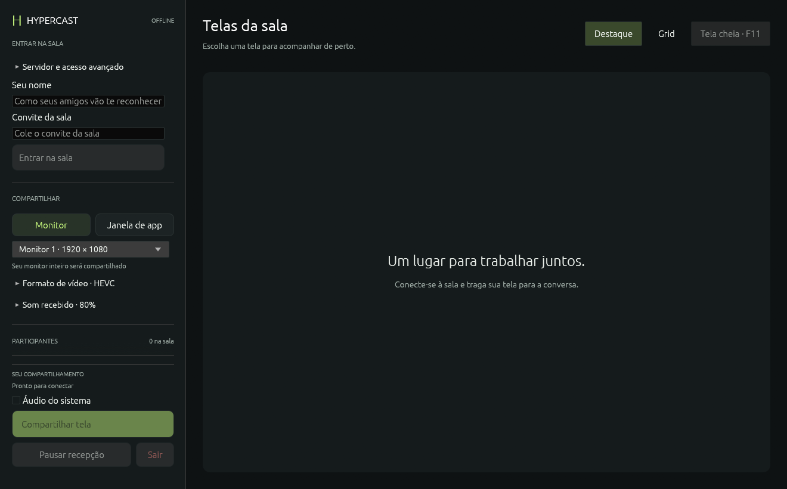

# HyperCast

Versão 0.4.1: configurações e controles na lateral, com mais espaço para as
telas da sala. Compartilhar/parar, pausar recepção e sair permanecem fixos;
formato e som recebido ficam em seções expansíveis.

Versão 0.4.0: seleção de **janelas de aplicativos com áudio do processo**,
troca de monitor/janela durante o envio, **tela cheia (F11/Esc)** e retomada de
publicação após reconexão. Veja [uso e limitações](docs/window-sharing.md).

Áudio do sistema está disponível na versão 0.3.0: captura WASAPI sem microfone,
Opus estéreo 48 kHz, volume/silenciamento e recepção conforme Grid/Destaque.
Marque **Áudio do sistema** na interface. Requer Windows 11/build
20348+ para excluir a saída do próprio aplicativo e evitar eco. Veja
[áudio do sistema](docs/system-audio.md).



Aplicativo nativo Windows para compartilhar telas por SFU LiveKit centralizado. Pipeline DXGI → NVENC → WebRTC → D3D11VA → swapchain DirectX, interface egui e até três publicadores por sala. Imagens brutas ficam na GPU; cópias entre texturas GPU e bitstream comprimido em RAM fazem parte do pipeline.

AV1 e HEVC, apresentação GPU, três publicadores e Grid/Destaque foram exercitados em 1920×1080. **1440p@120 estáveis e latência fim a fim <100 ms são metas ainda não comprovadas.** Veja [validação](docs/validation.md).

Uma amostra AV1 na RTX 4080 confirmou codificação 2560×1440 a 120,05 FPS médios durante 30 s e recepção QHD em D3D11VA. O desktop teve apenas 87 atualizações distintas; estabilidade com movimento contínuo, FPS efetivo do receptor e latência fim a fim ainda exigem medição.

## Usar o aplicativo

Abra `hypercast.exe` do ZIP ou instale a versão por usuário. Os pacotes incluem bibliotecas de mídia: o usuário não precisa instalar Rust, Python, FFmpeg ou Visual C++ Redistributable. Precisam de Windows 10 2004+ x64 e driver gráfico compatível. Publicação usa NVIDIA NVENC, driver 610+; AMF não está implementado.

Informe nome e convite, entre, escolha o monitor e use **Compartilhar minha tela**.
Servidor público já vem preenchido; JWTs são obtidos automaticamente via HTTPS.
Todos os membros do convite padrão podem compartilhar, com até três telas
simultâneas e doze participantes. Convite não é persistido pelo cliente. API secret
fica exclusivamente no servidor. [Convites e operação](docs/invitations.md).

HEVC/H.265 é o padrão da interface. Logs automáticos ficam em `%LOCALAPPDATA%/HyperCast/diagnostics/gui-*.log`; use **Copiar diagnóstico** para enviar o log da execução atual. São limitados e não gravam imagens ou JWTs. A captura tenta reconstruir o pipeline após mudança de device/resolução; veja [validação](docs/validation.md).

**Grid** recebe até três telas. **Destaque** recebe a escolhida e cancela as outras subscrições. Miniaturas guardam o último quadro visto: são estáticas, sem tráfego ou decode contínuo. Clique no participante/nome da miniatura para trocar o foco. **Pausar recepção** cancela todas as subscrições. Minimizar também pausa; restaurar reaplica a seleção anterior. O SFU não transcodifica nem produz versões reduzidas.

## Servidor e tokens

```powershell
python tools/init_env.py
docker compose -f docker-compose.yml -f docker-compose.dev.yml up -d --build
python tools/room_token.py --room amigos --name Lucas --role publisher
python tools/room_token.py --room amigos --name Amigo --role viewer
```

Esses comandos de JWT são para diagnóstico/desenvolvimento; o modo Token manual
permanece na interface. Em produção, use convites criados por
`python -m tools.room_invite`. `init_env.py` cria chaves aleatórias sem sobrescrever
`.env`. Nenhuma chave de servidor deve entrar no instalador.

Compose principal: rede host para Linux. Override: Docker Desktop, sinalização
em loopback. Cliente exige WSS fora de loopback e valida certificado. Produção
k3s usa wss://hypercast.cloudlane.com.br e TURN externo TLS TCP 5349; teste
relay-only HEVC passou com decode D3D11. Redes que permitem apenas TCP 443 ainda
podem bloquear 5349. [Estado do homelab](docs/homelab.md),
[TURN](docs/turn-tls.md), [manifests/operação](k8s/README.md).

| Porta | Transporte | Função |
|---|---|---|
| 8100 | TCP | Sinalização e RoomService |
| 8101 | TCP | ICE/TCP |
| 8102–8105 | UDP | RTP/RTCP mux |

`infra/90-hypercast.conf`: ajustes opcionais de socket no host Linux. O buffer NACK de 1024 pacotes é histórico de retransmissão, não playout delay. Encoder permite 35–45 Mbps, sujeito a adaptação por congestionamento.

## Quota de compartilhamentos

`HYPERCAST_MAX_PUBLISHERS` aceita 1–3 no SFU. Todos os membros podem entrar com
permissão para compartilhar; o SFU reserva quota atomicamente antes de aceitar
uma publicação. Até três telas pendentes/ativas, uma por participante. A quarta
publicação é recusada; parar uma tela libera a vaga sem sair da sala.

O LiveKit customizado aceita identidades de membro emitidas pelo backend e as
identidades antigas de diagnóstico. Outras fontes e segunda tela do mesmo membro
são recusadas antes da publicação; SDK recebe `LIMIT_EXCEEDED`. Trocar pelo
LiveKit oficial remove essa proteção. Quota é local ao SFU de uma réplica;
migração de publicadores entre salas/nós não está habilitada. Limites YAML do nó
não substituem essa quota. Sala permite doze participantes e três subscrições.

## Desenvolvimento e instalador

Rust 1.92+ (testado 1.99), Visual Studio C++/Windows SDK e Git. O helper configura MSVC/CRT estático e baixa FFmpeg LGPL fixado por SHA256. DLLs são resolvidas ao lado do executável para evitar colisão com o FFmpeg incorporado no libwebrtc.

```powershell
./tools/cargo-native.ps1 build --locked --features desktop
./target/x86_64-pc-windows-msvc/debug/hypercast.exe --gui
./tools/cargo-native.ps1 test --locked --features desktop
winget install --id JRSoftware.InnoSetup --exact
./tools/package.ps1
```

Saídas em `dist/`: instalador por usuário, ZIP portátil e SHA256SUMS. Build sem assinatura Authenticode. [Licenças](docs/THIRD_PARTY.md), [manual portátil](docs/portable.md) e [patches do SDK](vendor/README.md).

## Diagnósticos e testes

O CLI mantém captura/encode/publicação e recepção sem janela. Use `HYPERCAST_ROOM_TOKEN` no ambiente, nunca na linha de comando. Publicação: `--encode --codec av1 --fps 120 --seconds 30 --publish-url ws://127.0.0.1:8100`. Espectador: `--receive-url ws://127.0.0.1:8100 --view-mode grid --seconds 30`. Destaque aceita `--focus hc-screen-1`; `--pause-after 6` testa pausa. `--list` enumera monitores. `--dump` grava bitstream somente quando solicitado explicitamente.

O iniciador Test-Publisher.cmd usa HEVC/H.265 por padrão. RTX 20/30, incluindo RTX 3090, não possuem encoder AV1; selecione HEVC na interface. Para testar AV1 em hardware compatível, use Test-Streaming.ps1 -Role Publisher -Codec av1. A ponte consulta os codecs anunciados pelo driver antes do preset e rejeita opções incompatíveis com uma mensagem específica.

```powershell
python -m unittest discover -s tests -v
python -m tests.integration_tokens
python -m tests.integration_quota
python -m tests.integration_media
python -m tests.integration_desktop
python -m tests.integration_multishare
python -m tests.integration_gui_publish
```

Integrações de mídia exigem GPU e SFU local. Screenshots de QA ficam apenas em `.tools`, ignorado pelo Git; o teste visual exige Pillow no ambiente de desenvolvimento. CI compila/testa sem GPU e valida autenticação e build/testes do SFU.

## Limites da versão

Interface publica AV1 (padrão) ou HEVC, selecionável antes de compartilhar, camada única, P1 ultra-low-latency, CBR, sem B-frames/lookahead e GOP de um segundo. DXGI é não bloqueante; timer de alta resolução descarta ticks perdidos. Desktop estático repete a última imagem: 120 frames codificados/s não significam 120 mudanças distintas de conteúdo.

Capturas HDR em scRGB/FP16 são convertidas na GPU para SDR antes do NVENC; a transmissão não preserva HDR. Não há AMF, composição de cursor separado, miniaturas vivas em camada reduzida ou recuperação automática completa após falha de rede/dispositivo. `ACCESS_LOST` tenta reconstruir DXGI no mesmo dispositivo. Há dois peer connections **para o mesmo SFU** por conflito ICE observado no modo single-PC da combinação fixada. Latência, jitter/perda, alta movimentação e 1440p@120 precisam de medição antes de uso em produção.
